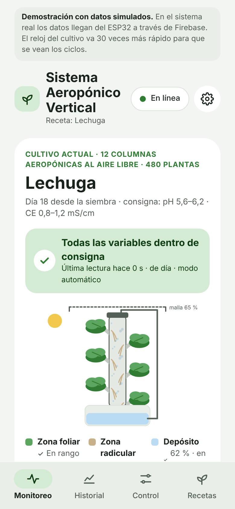
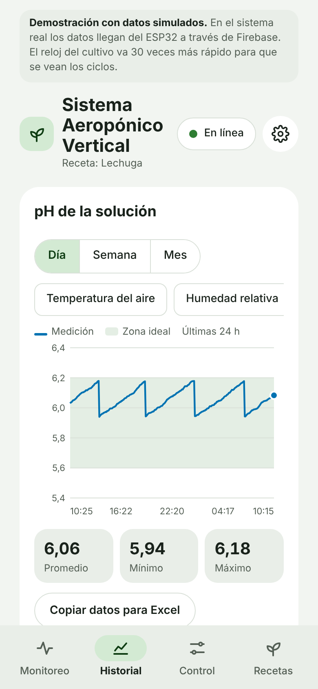
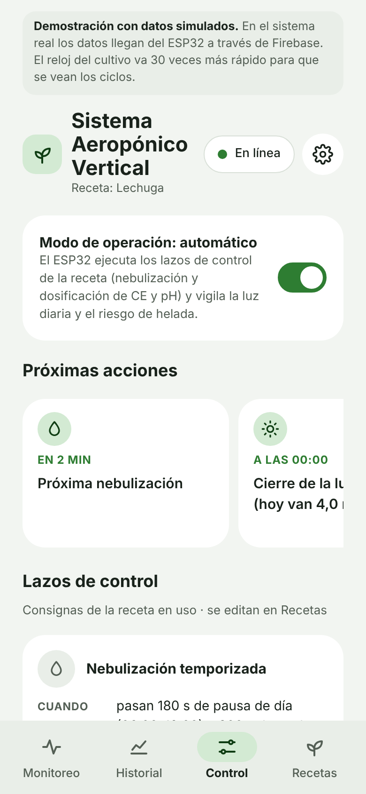
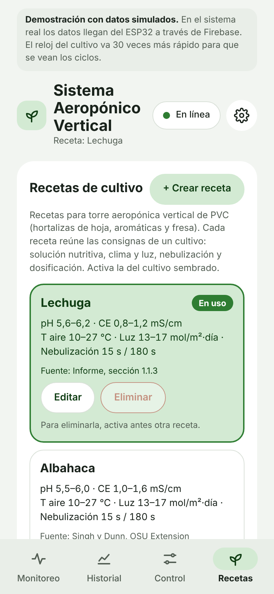
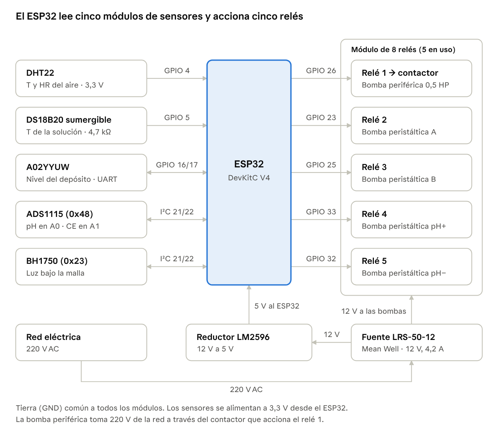
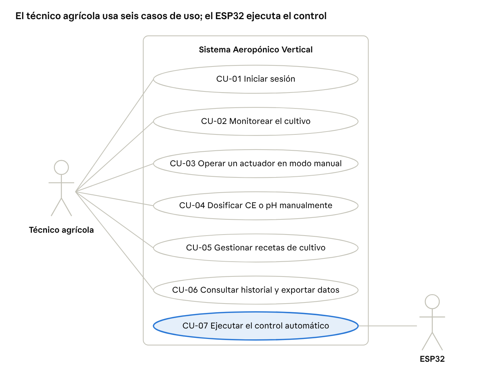

# Sistema Aeropónico Vertical

Sistema de monitoreo y control automatizado con **ESP32** para un cultivo aeropónico vertical de lechuga en torres de PVC, con una aplicación web para el personal técnico agrícola.

> Proyecto personal de **Hobi Jhunior Arotoma Quilca**. Lo diseñé y desarrollé a la medida de un cultivo real en Ayacucho (Perú) y lo sigo mejorando por mi cuenta.



## Qué hace

- Mide 7 variables: temperatura y humedad del aire, luz diaria (DLI), nivel del depósito, conductividad (CE), pH y temperatura de la solución.
- Controla la nebulización por ciclos de día y de noche, y dosifica los concentrados A y B y el corrector de pH con tiempo de mezcla.
- Avisa de heladas, de la falta o el exceso de luz, del nivel bajo del depósito y de los sensores que no responden.
- Sigue controlando el cultivo aunque se caiga el internet: la lógica vive en el ESP32.
- Usa recetas por cultivo (lechuga, albahaca, espinaca, perejil y fresa) que se pueden crear, editar y eliminar.

## Demostración

Abre `index.html` en el navegador. Funciona sin instalar nada y con **datos simulados**: el reloj del cultivo va 30 veces más rápido para que se vean los ciclos. En **Ajustes → Probar situaciones** puedes provocar una helada, vaciar el depósito o cortar el WiFi.

| Monitoreo | Historial | Control | Recetas |
|---|---|---|---|
|  |  |  |  |

## Arquitectura

ESP32 (sensores y relés) ⇄ Firebase Realtime Database ⇄ aplicación web. La web nunca habla directamente con el ESP32: ambos se comunican a través de Firebase.



| Función | Componente |
|---|---|
| Microcontrolador | ESP32-DevKitC V4 |
| Temperatura y humedad del aire | DHT22 |
| Temperatura de la solución | DS18B20 sumergible |
| pH y conductividad | DFRobot SEN0161-V2 y DFR0300, a través de un ADS1115 |
| Nivel del depósito | DFRobot A02YYUW (ultrasónico) |
| Luz | BH1750 |
| Actuadores | Módulo de 8 relés, contactor para la bomba de 0,5 HP y 4 bombas peristálticas Kamoer NKP de 12 V |
| Alimentación | Mean Well LRS-50-12 y reductor LM2596 a 5 V |

## Casos de uso



## Estructura

```
index.html          Aplicación web (demostración con datos simulados)
docs/capturas/      Capturas de la aplicación
docs/diagramas/     Diagramas de casos de uso y de conexiones
firmware/           Código del ESP32 (en preparación)
```

## Tecnologías

HTML, CSS y JavaScript sin dependencias · ESP32 con el núcleo Arduino · Firebase (Realtime Database, Authentication y Hosting).

## Autor

**Hobi Jhunior Arotoma Quilca** · Ingeniero de Sistemas (UNSCH) · [LinkedIn](https://www.linkedin.com/in/hobiarot)
